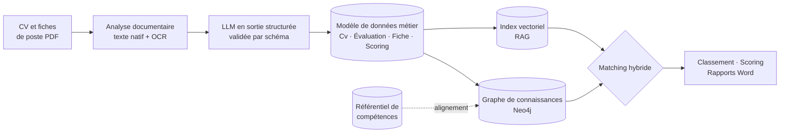

<div align="center">


# CVMatcher : la plateforme IA de gestion des candidats, offerte par Acceliance

**Pour les ESN, les cabinets de recrutement et les DRH : vos CV, vos fiches de poste et vos matchings sur une plateforme IA souveraine, déployée chez vous, sans frais de licence.**

[](https://www.acceliance.fr)
[](mailto:contact@acceliance.fr?subject=Licence%20CVMatcher)
[](https://github.com/acceliance/CVMatcher-Deploy/commits/main)
[](https://hub.docker.com/u/acceliance)
[](https://neo4j.com/)
[](#-lia-au-service-de-votre-métier--rag--graphe--modèle-de-données)
[](#-11-ouverture-aux-agents-ia)
[](https://www.modelio.org/)
[](https://ubuntu.com/)
[](#-14-sécurité-rgpd-et-ai-act)
[](#-déploiement-souverain)

</div>

> **Vous êtes une ESN ou une DRH ?** Acceliance vous **offre** CVMatcher : une licence gratuite et perpétuelle, sur simple
> demande à **[contact@acceliance.fr](mailto:contact@acceliance.fr?subject=Licence%20CVMatcher)**.
> Vous l'installez sur votre propre serveur, vos données restent chez vous.

---

## 🚀 Pourquoi CVMatcher ?

Chaque jour, vos équipes reçoivent des dizaines de CV hétérogènes et des fiches de poste clients en PDF. Les rapprocher
reste un travail manuel, lent et peu traçable. Puis il faut remettre chaque dossier aux couleurs de votre société avant
de le présenter au client.

**CVMatcher automatise toute la chaîne, de la réception du PDF au dossier de candidature prêt à envoyer :**

| | Avant | Avec CVMatcher |
|---|---|---|
| 📥 **Acquisition** | Ressaisie manuelle des CV | CV PDF, natifs ou **scannés**, structurés automatiquement par l'IA |
| 🎯 **Qualification** | Lecture subjective | Évaluation objective de chaque compétence, avec preuves tirées des expériences |
| 🔎 **Sourcing** | Recherche par mots-clés | Les meilleurs profils d'un vivier de **20 000 CV** classés en quelques minutes |
| 📊 **Décision** | Intuition | Scoring argumenté CV × fiche de poste, rapport Word prêt à partager |
| 🎨 **Présentation** | Mise en forme à la main | CV Word aux couleurs de votre société, en version standard ou optimisée pour la mission |
| 🔐 **Conformité** | Fichiers dispersés | RGPD intégré : durées de conservation, droit à l'effacement, décision humaine tracée |

---

## 🧠 L'IA au service de votre métier : RAG + graphe + modèle de données

CVMatcher n'est pas un simple chatbot posé sur des documents. Il s'appuie sur **l'état de l'art de l'IA générative**,
structurée par une architecture conçue pour la fiabilité :



- 🧩 **Un modèle de données métier qui fait foi.** CV, expériences, compétences, évaluations, fiches de poste, scorings :
  chaque objet est décrit dans un modèle UML gouverné sous Modelio. Les schémas JSON qui contraignent l'IA en sont
  générés. **Toute sortie de l'IA est validée contre ce schéma** avant d'être enregistrée ; un objet invalide n'est
  jamais persisté.
- 🕸️ **Un graphe de connaissances (Neo4j).** Candidats, expériences et compétences sont reliés à un **référentiel de
  compétences** hiérarchisé (compétence → famille → thématique → domaine). Le matching parcourt ce graphe : une
  compétence exacte, de la même famille ou de la même thématique n'a pas le même poids.
- 📚 **Un RAG vectoriel.** Chaque CV produit une fiche synthétique et des embeddings par expérience. La recherche
  sémantique rattrape les profils dont les compétences sont formulées autrement, puis elle est fusionnée avec la
  composante graphe.
- ⚖️ **Le LLM apprécie, le code calcule.** Durées, scores composites, moyennes pondérées et seuils sont recalculés par du
  code déterministe : les résultats sont reproductibles et explicables.
- 👤 **L'humain valide.** Chaque objet extrait passe au statut « À valider » et reste modifiable avant usage.

### 🧭 One-Model-Centric : un seul modèle, gouverné par des experts

Si CVMatcher reste **performant et cohérent sur toute la chaîne de valeur**, de l'acquisition du CV au rapport de
scoring, c'est parce qu'il a été architecturé de façon **One-Model-Centric** : un modèle unique fait référence pour
l'ensemble de la plateforme, et tout le reste en découle.

- 👥 **Une double expertise aux commandes.** Le modèle est gouverné conjointement par un **architecte Data** et un
  **expert en recrutement** d'Acceliance : la rigueur de la modélisation au service de la réalité du métier. Chaque
  concept (compétence, expérience, indicateur, score) a une définition unique, partagée par tous les traitements.
- 🏗️ **Une gouvernance qui produit, pas seulement qui documente.** Elle inclut la **génération des schémas de structure
  JSON** qui encadrent les sorties de l'IA, ainsi que celle du **modèle global du graphe** de connaissances. Schémas et
  graphe sont issus de la même source : ils ne peuvent pas diverger.
- 🎯 **Une inférence cohérente dans tous les scénarios de travail.** Extraction, évaluation, scoring, recherche de
  profils, génération de documents : quelle que soit la tâche, l'IA raisonne sur les mêmes objets, avec les mêmes
  règles. Un CV structuré aujourd'hui reste comparable, scorable et exploitable demain, sans retraitement.

---

## 🏆 La vitrine du savoir-faire Acceliance

CVMatcher est la **démonstration concrète du savoir-faire d'Acceliance en architecture et en design de solutions
d'automatisation par IA** :

- **One-Model-Centric** : un modèle de données unique, gouverné par un architecte Data et un expert en recrutement,
  d'où sont générés les schémas JSON, les contrats LLM et le modèle du graphe ;
- **IA gouvernée** : prompts versionnés, garde-fous contre l'injection de prompt, contrôles de vraisemblance, suivi des
  coûts (FinOps) ;
- **Architecture hybride graphe + vecteurs**, pensée pour passer à l'échelle sans exploser les coûts d'IA ;
- **Souveraineté et conformité** dès la conception : on-premise, LLM local possible, RGPD et AI Act ;
- **Ouverture aux agents** : MCP et A2A pour intégrer CVMatcher dans vos copilotes et orchestrateurs.

Vous voulez la même approche pour vos propres processus métier ? **[Parlons-en](mailto:contact@acceliance.fr?subject=Projet%20IA)**.

---

## ✨ Fonctionnalités

### 📥 1. Acquisition des CV (WF-01)

- Import **unitaire ou en lot** de CV au format PDF (jusqu'à 200 fichiers par envoi).
- **PDF natifs, scannés ou mixtes** : la reconnaissance de caractères (OCR) est intégrée et s'exécute dans un conteneur
  **isolé, sans accès réseau**. Un mode *vision* optionnel envoie les pages difficiles (photos, tableaux) au LLM.
- **Contrôle de pertinence** : un document qui n'est pas un CV est rejeté avant tout appel d'extraction coûteux.
- Extraction structurée : identité, expériences, missions, compétences, formations, certifications, langues.
- **Alignement automatique sur le référentiel de compétences**, avec propositions d'enrichissement pour les compétences
  nouvelles.
- Détection des doublons et écran de revue avec alertes de vraisemblance (dates futures, durées incohérentes, etc.).

### 🎯 2. Évaluation des CV (WF-02)

- Évaluation objective de **chaque compétence démontrée** : durée cumulée, fraîcheur, niveau, expériences citées en
  preuve.
- Score composite par compétence et **note globale sur 20**, calculés par du code déterministe.
- Recalcul automatique à chaque modification du CV.

### 📄 3. Acquisition des fiches de poste (WF-03)

- Import des fiches de poste clients en PDF, natives ou scannées.
- Extraction des **indicateurs de compétences pondérés** : obligatoires ou souhaités, niveau attendu, poids.
- Validation et ajustement par le commercial ou le recruteur.

### 📊 4. Scoring CV × fiche de poste (WF-04)

- Notation argumentée de chaque indicateur de la fiche face au CV, **CV anonymisé** avant l'envoi au LLM.
- Score global, points forts, écarts, risques et **recommandation**.
- **Décision humaine** obligatoire et tracée (aide à la décision, article 22 du RGPD et AI Act).
- Journal détaillé du traitement : étapes, durées, modèle utilisé, jetons consommés.

### 🔎 5. Identification des CV pertinents (WF-05)

Le matching qui fait la différence, en **trois étages** pour concilier précision et coût :

| Étage | Méthode | Volume | Durée |
|---|---|---|---|
| 1 | Parcours du **graphe** de compétences + recherche **vectorielle (RAG)**, sans LLM | 5 000 à 20 000 CV → 200 à 500 | < 2 s |
| 2 | Classement **LLM par lots** sur des fiches synthétiques compactes | → top 30 à 50 | quelques minutes |
| 3 | Scoring complet (WF-04) sur le top N confirmé par l'utilisateur | → short-list | à la demande |

- Filtres éliminatoires (indicateurs obligatoires) et facultatifs : fraîcheur, langues, certifications, mots-clés.
- Résultats paginés : score de pertinence, indicateurs couverts ou manquants, durée sur les compétences clés.
- Un vivier de 5 000 CV coûte de l'ordre de **0,2 à 0,5 $** d'IA à classer avec un modèle économique.

### 🎨 6. CV aux couleurs de votre société (WF-06)

- Génération du CV au format **Word (DOCX)** à partir de **votre propre modèle Word**.
- Trois versions : **standard**, **impact minimal** et **impact optimisé** pour une fiche de poste cible, avec mise en
  valeur des compétences clés.
- Version **anonymisée** pour les diffusions sans données personnelles.

### 📑 7. Rapport de scoring Word (WF-07)

- Rapport de scoring au format DOCX, à partir de votre modèle de rapport : synthèse, détail par indicateur,
  recommandation, décision.

### 🗂️ 8. Gestion documentaire

- Stockage des PDF sources et des documents générés, explorateur de fichiers, visualisation intégrée.
- Stockage local ou **S3** (hébergeur compatible S3, ou SeaweedFS dans l'instance), quota paramétrable.
- Exports tracés.

### 📚 9. Référentiel de compétences

- Référentiel initial livré, organisé en domaines, thématiques, familles et compétences, avec alias.
- Gestion par un rôle dédié (`steward`) : création, fusion, validation des propositions détectées dans les CV.
- Paramètres de calcul ajustables (coefficients de proximité, seuils).

### 🤖 10. Gestion de l'IA

- **Multi-fournisseur** : Anthropic, OpenAI, Mistral, serveur **on-premise compatible OpenAI** (vLLM, Ollama, LM Studio,
  Open WebUI), Voyage AI et **embeddings locaux** exécutés dans l'instance.
- **Slots par usage** (classification, extraction, évaluation, scoring, génération, vision, agent, embeddings) : le bon
  modèle au bon endroit, avec connexion de repli.
- Contrôle de la **sortie des données** : chaque connexion déclare si les données restent dans l'instance, dans votre SI
  ou partent à l'extérieur ; l'exploitation peut interdire toute sortie.
- Clés d'API **chiffrées en base**, testées avant enregistrement, modifiables sans redémarrage.
- **Prompts éditables**, versionnés, avec jeu d'essai, différentiel et retour arrière ; règles produit non retirables.
- ✍️ **Besoin d'écrire ou d'affiner un prompt ?** Acceliance met à votre disposition un générateur de prompts :
  **[MasterPrompter](https://masterprompter.acceliance.fr)**.
- **FinOps** : coût par CV, par fiche, par utilisateur, rapproché de la facture du fournisseur ; budgets et plafonds.

### 🔌 11. Ouverture aux agents IA

- **API REST** pour vos ATS, CRM et scripts.
- Serveur **MCP** : interrogez CVMatcher depuis Claude Desktop, Copilot ou tout hôte MCP (« quels profils Kubernetes
  confirmés sont disponibles pour cette mission ? »).
- Protocole **A2A** : déléguez une tâche entière (« trouve et score les 10 meilleurs candidats pour la fiche X »).
- Clés d'agent individuelles, portées et rôle, données **pseudonymisées par défaut**, limitation de débit et audit.

### 👥 12. Utilisateurs et rôles

| Rôle | Profil |
|---|---|
| `administrator` | Responsable de l'instance : utilisateurs, licence, thème, modèles Word, IA, prompts, sauvegardes |
| `steward` | Gestionnaire du référentiel de compétences |
| `recruiter` | Chargé de recrutement, sourceur : CV, évaluations, scorings, documents |
| `business_manager` | Commercial, ingénieur d'affaires : fiches de poste, recherche, scorings, documents |
| `visitor` | Lecteur : consultation avec données personnelles masquées |

- Authentification **autonome** (comptes de l'application) ou **fédérée** : Microsoft Entra ID (Office 365) ou Google
  Workspace, avec correspondance optionnelle des groupes de l'annuaire vers les rôles.

### 🎨 13. Personnalisation

- **Thème** de l'interface (couleurs, polices, logos) par simple fichier JSON ; un exemple et un prompt pour le
  produire depuis votre site web sont fournis dans [`samples-theme/`](samples-theme/README.md).
- **Modèles Word** du CV et du rapport de scoring fournis par vous ; une notice, un prompt et un générateur pour les
  produire aux couleurs de votre site web sont fournis dans [`samples-template/`](samples-template/README.md).
- Aucun élément propre à un client n'est embarqué dans les images : tout se charge après l'installation.

### 🔐 14. Sécurité, RGPD et AI Act

- Date de collecte, source et base légale sur chaque CV ; **durée de conservation** paramétrable (24 mois par défaut,
  recommandation CNIL) avec purge ou anonymisation automatique.
- **Droit d'accès, de portabilité et d'effacement** en un clic.
- **Pseudonymisation avant envoi** au fournisseur IA.
- **Registre de traitement RGPD** pré-rempli livré dans [`registre-rgpd/`](registre-rgpd/), avec une
  [notice pour le compléter](registre-rgpd/README.md).
- Défense contre l'injection de prompt dans les CV, contrôle des fichiers téléversés, chiffrement des secrets au repos.
- Conteneurs durcis (non-root, lecture seule), audit de toutes les actions, sauvegarde nocturne chiffrée.

---

## 🇫🇷 Déploiement souverain

CVMatcher s'installe **chez vous** : une instance par société, sur **votre** VM, dans **votre** datacenter ou chez
l'hébergeur de votre choix. Ce dépôt contient tout le nécessaire ; il ne contient aucun code applicatif. Les images sont
publiques sur Docker Hub (`acceliance/cvmatcher-{app,web,docproc}`) et se téléchargent sans compte.

### Contenu du kit

| Dossier | Contenu |
|---|---|
| [`kit/compose/`](kit/compose/) | Compose de production (pull uniquement) et `.env.example` ; profils optionnels `federated` (OIDC), `vectors-qdrant`, `files-seaweedfs`, `local-llm` |
| [`kit/ubuntu/`](kit/ubuntu/) | Provisioning de la VM (`provision.sh` enchaîne 00 à 09), démarrage (`deploy-app.sh`), sauvegarde et restauration |
| [`instances/_template/`](instances/_template/) | Gabarit de fiche d'instance ; `new-instance.ps1` crée `instances/<fqdn>/`. Exemple de journal rempli : [`notes.exemple.md`](instances/_template/notes.exemple.md) |
| [`licensing/`](licensing/README.md) | Dépôt de la licence remise par Acceliance |
| [`scripts/`](scripts/) | `new-instance`, `deploy`, `upgrade`, `backup-now`, `restore`, `decommission`, `check-repo` |
| [`samples-template/`](samples-template/README.md) | Gabarits Word d'exemple (deux sociétés fictives), générateur, prompt et notice pour produire vos gabarits depuis votre site web |
| [`registre-rgpd/`](registre-rgpd/README.md) | Registre de traitement RGPD pré-rempli et notice pour le compléter |
| [`schemas/`](schemas/) | Schéma JSON du thème (`brand-theme.schema.json`), pour valider un thème dans l'éditeur |
| [`samples-theme/`](samples-theme/README.md) | Thème Acceliance en exemple et prompt de production d'un thème depuis le site web d'un client |

### Architecture de l'instance

| Service | Rôle |
|---|---|
| `cvmatcher-web` | Interface web et edge nginx (en-têtes de sécurité, authentification) |
| `cvmatcher-api` | API REST, MCP et A2A |
| `cvmatcher-worker` | Traitements IA asynchrones, génération des documents |
| `cvmatcher-docproc` | Analyse des PDF et OCR, **sur un réseau interne sans accès extérieur** |
| `neo4j` | Magasin unique : graphe, données métier et index vectoriel |
| `oauth2-proxy` | *Profil `federated`* : authentification Entra ID ou Google |
| `qdrant` | *Profil `vectors-qdrant`* : index vectoriel dédié pour les très gros viviers |
| `seaweedfs` | *Profil `files-seaweedfs`* : stockage S3 dans l'instance |
| `local-llm` | *Profil `local-llm`* : LLM local (Ollama), GPU optionnel |

Sur l'hôte : Apache en reverse proxy HTTPS (Let's Encrypt), pare-feu `ufw`, mises à jour de sécurité automatiques,
sauvegarde nocturne, et en option Cockpit pour l'administration web.

### Étape 0 — Prérequis

- La **licence** `instance.lic` remise par Acceliance (gratuite, sur demande à
  [contact@acceliance.fr](mailto:contact@acceliance.fr?subject=Licence%20CVMatcher), en précisant le nom de domaine de
  l'instance).
- Une **VM Ubuntu 22.04, 24.04 ou 26.04 LTS** : 4 vCPU et 8 Go de RAM au minimum ; un GPU si vous visez un LLM local.
  Le provisioning ajoute un swap de 4 Go si la VM n'en a pas (variable `SWAP_SIZE` pour changer la taille).
- Un **enregistrement DNS** du nom de domaine de l'instance (FQDN) vers la VM.
- Un **accès SSH par clé** à la VM, avec un utilisateur `sudo`.
- Sur votre poste : **PowerShell 5.1 ou 7**, `ssh` et `scp`, et ce dépôt cloné.

### Étape 1 — Créer la fiche d'instance

```powershell
./scripts/new-instance.ps1 cv.client.fr -Customer "Client SA" -AdminIp 203.0.113.10 -AuthMode standalone
```

Le script crée `instances/cv.client.fr/` à partir du gabarit et **génère des secrets aléatoires** propres à
l'instance. Options utiles :

| Option | Effet |
|---|---|
| `-AdminIp` | Seule adresse autorisée en SSH (et sur Cockpit) |
| `-CustomerIps` | Adresses autorisées en HTTPS ; vide = ouvert à tous |
| `-AuthMode office365 -OidcTenant <id> -AllowedDomains client.fr` | Authentification Entra ID ; `google` pour Google Workspace |
| `-FileStore s3 -S3Target seaweedfs` | Fichiers sur un S3 interne à l'instance ; `hosting` pour le S3 de votre hébergeur |
| `-Tag` | Version des images : `latest` par défaut ; un tag versionné (ex. `v37-86577d8`) fige la version |

Relisez ensuite `config.env` (hôte, sauvegarde) et `config.app.env` (application) dans le dossier de l'instance. Ces
fichiers contiennent des secrets : ils ne sont jamais versionnés. Le journal `notes.md` (hébergement, contacts,
historique des mises à jour, procès-verbal de recette) n'est pas versionné non plus ; un exemple fictif rempli est
fourni dans [`instances/_template/notes.exemple.md`](instances/_template/notes.exemple.md).

Le dossier de l'instance est indispensable à `deploy.ps1`, `upgrade.ps1`, `backup-now.ps1` et `restore.ps1` : sauvegardez-le
(coffre ou partage protégé). `CVM_INSTANCES_DIR` permet de le placer hors de ce dépôt.

### Étape 2 — Choisir le niveau de souveraineté de l'IA

| Niveau | Configuration | Les CV quittent-ils votre SI ? |
|---|---|---|
| 🟢 **100 % local** | `COMPOSE_PROFILES=…,local-llm` et `AI_EGRESS_ALLOWED=false` ; connexion « on-premise » vers `http://local-llm:11434/v1` | **Non**, rien ne sort de l'instance |
| 🟡 **Dans votre SI** | `AI_EGRESS_ALLOWED=false` ; connexion vers votre serveur vLLM, Ollama ou LM Studio | Non, ils restent dans votre réseau |
| 🔵 **Fournisseur cloud** | `AI_EGRESS_ALLOWED=true` ; connexion Anthropic, OpenAI ou Mistral, pseudonymisation avant envoi recommandée | Oui, vers le fournisseur choisi |

Les embeddings sont calculés **localement** par défaut, quel que soit le niveau retenu. Avec `AI_EGRESS_ALLOWED=false`,
l'application refuse d'enregistrer **et** d'appeler toute connexion externe.

### Étape 3 — Déployer

```powershell
./scripts/deploy.ps1 cv.client.fr -Stage kit,config,provision,app -Licence <paquet>/instance.lic
```

Le script vérifie la fiche d'instance et la correspondance entre la licence et le domaine, affiche un résumé et demande
`OUI` avant d'agir. Il enchaîne ensuite :

| Étape | Action |
|---|---|
| `kit` | Copie du kit sur la VM (`/opt/cvmatcher-kit`) |
| `config` | Copie de la configuration de l'instance |
| `provision` | Contrôles préalables (OS, ressources, DNS), mises à jour, pare-feu, Docker, Apache, certificat Let's Encrypt, Cockpit en option, sauvegarde nocturne, installation dans `/opt/cvmatcher`, durcissement HTTPS (HSTS) |
| `app` | Téléchargement des images et démarrage de la stack ; les migrations s'appliquent au démarrage |

Chaque étape peut être rejouée seule, par exemple `-Stage app`. `-WhatIf` montre ce qui serait fait sans rien modifier.

### Étape 4 — Configurer l'instance

Ouvrez `https://cv.client.fr` :

1. Créez le **premier compte** : il devient `administrator`.
2. **Administration ▸ Licence** : déposez `instance.lic` ([détails](licensing/README.md)).
3. **Administration ▸ IA** : créez vos connexions, affectez les slots, fixez le budget. Pour adapter les prompts
   (**Administration ▸ Prompts**), appuyez-vous sur le générateur [MasterPrompter](https://masterprompter.acceliance.fr).
4. **Administration ▸ Thème** et **Modèles Word** : vos couleurs, votre modèle de CV et de rapport.
5. **Référentiel** : relisez le référentiel de compétences initial.
6. **Utilisateurs** : créez les comptes et attribuez les rôles.
7. **Recette** : importez quelques CV et une fiche de poste, lancez un matching.

### Exploitation

| Besoin | Commande |
|---|---|
| Nouvelle version | `./scripts/upgrade.ps1 <fqdn> -Tag latest` (retélécharge les dernières images ; ou `-Tag <version>`), sauvegarde préalable, migrations au démarrage |
| Nouvelle version, sans fiche d'instance | `./kit/update.ps1 <utilisateur>@<hôte>` (retélécharge les images du tag courant ; `-Tag <version>` pour en changer, `-Prune` pour nettoyer les anciennes images), sauvegarde préalable |
| Rotation de la clé de chiffrement | `./scripts/upgrade.ps1 <fqdn> -RotateDataKey`, puis Administration ▸ Maintenance ▸ Rechiffrement |
| Sauvegarde immédiate | `./scripts/backup-now.ps1 <fqdn>` (la sauvegarde nocturne est installée par le provisioning) |
| Restauration | `./scripts/restore.ps1 <fqdn> -Backup /var/backups/cvmatcher/<horodatage>`, puis Administration ▸ Maintenance ▸ Vérification après restauration |
| Fin de vie | `./scripts/decommission.ps1 <fqdn>` |

En production, configurez une **copie externe chiffrée** des sauvegardes (`BACKUP_REMOTE`, `BACKUP_AGE_RECIPIENT` dans
`config.env`).

### Règles du kit

- Scripts PowerShell 5.1 ou 7 ; ils affichent un résumé et demandent `OUI` avant toute action (`-WhatIf` accepté).
  `CVM_ASSUME_YES=1` pour l'automatisation.
- Fichiers du kit en LF ; un fichier CRLF est refusé au déploiement.
- Aucun secret dans git : `config*.env`, `*.lic`, `*.pem` et les secrets sont ignorés ; `pre-commit install` active
  gitleaks et `scripts/check-repo.ps1`.

---

## 🎁 Licence : gratuite, sur simple demande

CVMatcher est **offert** aux ESN, cabinets de recrutement et DRH.

1. Écrivez à **[contact@acceliance.fr](mailto:contact@acceliance.fr?subject=Licence%20CVMatcher)** en indiquant le nom
   de votre société et le nom de domaine prévu pour l'instance (par exemple `cv.votre-societe.fr`).
2. Acceliance vous remet un fichier `instance.lic` signé, lié à ce domaine.
3. Déposez-le dans **Administration ▸ Licence** : l'effet est immédiat.

La licence est **perpétuelle**. Sans licence, l'instance reste utilisable pour un essai, limitée à 50 CV et sans les
fonctions agents (MCP, A2A).

---

## 🤝 À propos d'Acceliance

**Acceliance** conçoit des architectures et des solutions d'automatisation par IA : graphes de connaissances, RAG,
agents, modélisation métier, gouvernance de l'IA et déploiements souverains. CVMatcher en est la vitrine.

📧 [contact@acceliance.fr](mailto:contact@acceliance.fr) · 🌐 [www.acceliance.fr](https://www.acceliance.fr) ·
🐙 [github.com/acceliance](https://github.com/acceliance)

<div align="center">

**Vos candidats méritent mieux qu'un tableur. Vos données méritent de rester chez vous.**

</div>
