# CVMatcher-Deploy — Spécification d'instanciation et de déploiement

| Élément | Valeur |
|---|---|
| Version du document | 0.4 — 2026-10-29 : kit livré (lot 4) ; images `app`, `web`, `docproc` ; scripts `upgrade-fleet`, `decommission`, `check-repo`, inventaire de flotte ; correspondance groupe IdP → rôle (`OIDC_GROUP_ROLES`). 0.3 (draft) — 2026-10-23 : Neo4j, SeaweedFS, Qdrant, stockage de fichiers, procédures (bascule vectorielle §4.5, rotation des secrets §4.6, runbook de restauration §4.7). 0.2 — 2026-10-22 : authentification OIDC détaillée, variables et routes MCP / A2A, secrets séparés, coûts IA |
| Application | `cvmatcher` (voir `cvmatcher/Specifications/functional-specification-cvmatcher.md`, abrégé **SFG**) |
| Modèle de référence | `hubgov-application/deployment/` (kit `ubuntu`, `raw_from_harbor`, `ubuntu_instances/<fqdn>`, licensing) |
| Différence majeure avec HubGov | Le déploiement vit dans **un dépôt séparé** de l'application. Aucun code applicatif ici : uniquement des kits, des scripts et des fiches d'instance. |

---

## 1. Principe

Une **instance CVMatcher correspond à une société de recrutement**, avec :

- un FQDN dédié (par exemple `cvmatcher-<client>.acceliance.fr`, ou un domaine fourni par le client) ;
- une VM Ubuntu LTS dédiée, hébergée par Acceliance ou par le client ;
- une stack Docker tirée de Harbor (`harbor.acceliance.fr/cvmatcher/*`). Les images sont **identiques pour tous les clients** (SFG P-5).

Tout ce qui est propre au client est **soit** de l'infrastructure (dans ce dépôt, hors secrets), **soit** de la configuration applicative chargée par l'interface après installation.

| Propre au client | Où | Versionné ici ? |
|---|---|---|
| FQDN, IP d'administration, IP autorisées, e-mail Let's Encrypt | `instances/<fqdn>/config.env` | Non (gabarit `.example` versionné) |
| Tags d'images, port, robot Harbor `deploy-pull`, `AUTH_MODE`, paramètres OIDC | `instances/<fqdn>/config.app.env` | Non |
| Historique de l'instance, contacts, décisions | `instances/<fqdn>/notes.md` | **Oui** |
| Licence `.lic` | Livrée au client, uploadée dans l'UI | Non (le fichier signé reste dans `deliveries/`, hors git) |
| Thème `brand-theme.json`, logos | Uploadés dans l'UI (SFG §11.1) | Optionnel : `instances/<fqdn>/branding/` pour mémoire |
| Modèle Word à en-tête `cv-template.docx` | Uploadé dans l'UI (SFG §11.2) | Optionnel : `instances/<fqdn>/branding/` |
| Référentiel de compétences spécifique | Import dans l'UI (SFG EF-14) | Non |
| Clés IA (connexions, clés d'administration de coûts), slots, budget | Saisis dans l'UI (SFG §8.1, §8.4) | **Jamais** |
| Mode des clés IA (client ou managé), identifiants de workspace Anthropic / projet OpenAI dédiés à l'instance | `instances/<fqdn>/notes.md` (identifiants seulement, aucun secret) | **Oui** |
| Clés d'agents MCP / A2A | Créées dans l'UI (SFG EF-172), remises à l'intégrateur du client | **Jamais** |
| Enregistrement de l'application dans l'IdP (Entra ID ou Google), callback `https://<fqdn>/oauth2/callback` | `config.app.env` (identifiants) ; `notes.md` (tenant, date, contact) | `notes.md` seulement |

---

## 2. Structure du dépôt

```
CVMatcher-Deploy/
├── README.md
├── Specifications/
│   └── deployment-specification-cvmatcher.md   # ce document
├── kit/
│   ├── compose/                       # équivalent de raw_from_harbor : pull uniquement
│   │   ├── docker-compose.yaml
│   │   └── .env.example
│   └── ubuntu/                        # provisioning hôte (bash, LF uniquement)
│       ├── 00-preflight.sh            # OS, CPU/RAM/disque, DNS du FQDN → IP
│       ├── 01-system-update.sh
│       ├── 02-firewall.sh             # ufw : 22 (ADMIN_IP), 80/443 (CUSTOMER_IPS ou any)
│       ├── 03-docker.sh
│       ├── 04-apache.sh               # reverse proxy TLS → 127.0.0.1:8090
│       ├── 05-letsencrypt.sh          # certbot + timer systemd de renouvellement
│       ├── 06-cockpit.sh              # optionnel, restreint à ADMIN_IP
│       ├── 07-backup.sh               # timer systemd : dump Neo4j à froid + volumes, rétention, copie externe
│       ├── backup-run.sh / restore-run.sh  # installés en /usr/local/sbin/cvmatcher-{backup,restore}
│       ├── lib.sh                     # fonctions communes (config.env, refus CRLF)
│       ├── 08-stage-app.sh            # copie du kit compose dans /opt/cvmatcher
│       ├── 09-apache-finalize.sh
│       ├── provision.sh               # enchaîne 00 → 09
│       └── deploy-app.sh              # docker login (robot pull) + pull + up -d + healthcheck
├── instances/
│   ├── _template/
│   │   ├── config.env.example
│   │   ├── config.app.env.example
│   │   └── notes.md
│   ├── inventory.yaml                 # flotte : fqdn, environnement, tag, anneau de mise à jour
│   └── <fqdn>/                        # une fiche par instance client
│       ├── notes.md                   # seul fichier versionné
│       └── branding/                  # optionnel (thème, modèle Word de référence)
├── licensing/
│   ├── README.md                      # procédure d'émission ; la clé privée n'est PAS ici
│   ├── cvmatcher-licence.py           # keygen / pubkey / sign / verify (Ed25519, format de l'application)
│   └── deliveries/<client>/           # ignoré par git : compose, .env.example, .lic, guide
├── scripts/
│   ├── new-instance.ps1               # crée instances/<fqdn>/ depuis _template
│   ├── deploy.ps1                     # <fqdn> -Stage kit,config,provision,app
│   ├── upgrade.ps1                    # <fqdn> -Tag vX : sauvegarde, pull, migrations, up
│   ├── upgrade-fleet.ps1              # -Tag vX : par anneaux de inventory.yaml (recette d'abord)
│   ├── decommission.ps1               # <fqdn> : sauvegarde finale, arrêt, effacement
│   ├── check-repo.ps1                 # hook pre-commit et CI : variables internes, LF, fichiers sensibles
│   ├── backup-now.ps1 / restore.ps1
│   ├── new-customer.ps1               # prépare licensing/deliveries/<client>/
│   └── lib/guards.ps1                 # contrôles communs (voir §5)
├── templates/
│   ├── brand-theme.example.json
│   ├── cv-template.example.docx       # modèle Word nu d'exemple (styles requis SFG EF-71)
│   └── registre-traitement-rgpd.docx  # SFG EF-116
├── .pre-commit-config.yaml            # gitleaks + scripts/check-repo.ps1
├── .gitattributes                     # LF partout, CRLF pour *.ps1
└── .gitignore                         # *.env, *.lic, *.pem, *.key, *secret*, deliveries/, backups/
```

---

## 3. Stack déployée (`kit/compose/docker-compose.yaml`)

| Service | Image | Rôle | Ports |
|---|---|---|---|
| `cvmatcher-web` | `harbor.acceliance.fr/cvmatcher/web:${TAG}` | nginx : SPA et edge (auth, proxy `/api`, routes agents, §3.2) | `127.0.0.1:8090` (Apache TLS devant) |
| `cvmatcher-api` | `harbor.acceliance.fr/cvmatcher/app:${TAG}` | API FastAPI ; endpoints MCP et A2A (SFG §10.1) | interne |
| `cvmatcher-worker` | même image que l'API, commande `worker` | Jobs : extraction, IA, calculs, DOCX | interne, sortie HTTPS vers le fournisseur IA |
| `cvmatcher-docproc` | `harbor.acceliance.fr/cvmatcher/docproc:${TAG}` (PaddleOCR via RapidOCR / ONNX Runtime, modèles embarqués ; ni Tesseract ni Ghostscript, décision du 2026-10-23) | Qualification des pages, OCR des PDF scannés, PDF interrogeable, vignettes (SFG §6.0) | interne, réseau `internal: true` **sans sortie** |
| `neo4j` | `neo4j:5-community` (version figée) | Magasin canonique unique : graphe métier, état applicatif, file de tâches, audit, coûts, index vectoriel et plein texte (décision du 2026-10-23 : la persistance SQL n'est pas retenue ; `architecture-solution-cvmatcher.md` §4.4) | Bolt `127.0.0.1:7687` (tunnel SSH uniquement) ; Neo4j Browser non publié |
| `oauth2-proxy` | `quay.io/oauth2-proxy/oauth2-proxy` (version figée) | OIDC, profil `federated` | interne |
| `docx-preview` (V1.1) | `harbor.acceliance.fr/cvmatcher/docx-preview:${TAG}` | LibreOffice headless | interne, sans sortie réseau |
| `seaweedfs` (option, profil `files-seaweedfs`) | `chrislusf/seaweedfs:<version figée>` | Object store S3 **local**, tout-en-un (`weed server -dir=/data -filer -s3 -s3.config=/run/secrets/s3-config`), filer sur LevelDB embarqué. Cible de `FILE_STORE=s3` quand le client exige une API S3 interne ; **non déployé par défaut** (sur une VM unique, il n'ajoute aucune durabilité par rapport au volume local). Décision du 2026-10-23, architecture §4.4.8 | interne, aucun port publié ; identifiants dans le secret Docker `seaweedfs-s3.json` (hors git) ; volume nommé `seaweed-data` ; `metricsPort` 9324 lu par la supervision |
| `qdrant` (option, profil `vectors-qdrant`) | `qdrant/qdrant:<version figée>` | Index vectoriel externe à la place de l'index natif Neo4j. **Non déployé par défaut** : activé par instance quand l'un des déclencheurs de l'architecture (ADR-07) est atteint : plus de 300 000 vecteurs, kNN p95 > 500 ms, page cache Neo4j saturé, besoin de pré-filtrage | interne, sans sortie réseau ; clé API obligatoire (`QDRANT_API_KEY:?`) ; volume nommé `qdrant-data`, jamais de bind mount |

**Volumes** :

- `neo4j-data` : base Neo4j (données et transactions) ; `neo4j-logs` ;
- `cvm-files` : `/data/files`, qui contient les PDF sources et interrogeables, les DOCX générés, les modèles Word, les actifs du thème, les vignettes et aperçus, **adressés par hash** (`ab/cd/<sha256>.<ext>`, SFG EF-190) ; remplacé par un bucket S3 en mode `FILE_STORE=s3` ;
- `cvm-config` : `/data/config`, qui contient le thème, la licence, les prompts et les clés IA chiffrées.

**Durcissement** (repris de HubGov) :

- healthchecks sur chaque service, dont `depends_on: condition: service_healthy` ;
- `security_opt: no-new-privileges` et utilisateur non-root ;
- driver de logs `json-file` avec rotation `max-size` / `max-file` ;
- variables obligatoires en syntaxe `:?` (`NEO4J_PASSWORD`, `SESSION_SECRET`, `DATA_ENCRYPTION_KEY`) ;
- mémoire Neo4j dimensionnée par profil (§8) : `NEO4J_server_memory_heap_max__size` et `NEO4J_server_memory_pagecache_size` ; le page cache doit contenir les index vectoriels (environ 400 Mo pour 20 000 CV avec des embeddings de 1 024 dimensions).

### 3.1 Variables d'environnement

| Variable | Obligatoire | Description |
|---|---|---|
| `CVMATCHER_IMAGE_PREFIX`, `TAG` | Oui | Registre (`harbor.acceliance.fr/cvmatcher`, images `app`, `web`, `docproc`) et version (`v<commits>-<sha>`, jamais `latest` en production) |
| `INSTANCE_FQDN` | Oui | FQDN de l'instance (contrôles de licence et d'agents) |
| `HARBOR_PULL_USER` | Oui | Robot `deploy-pull` de l'instance ; son mot de passe vient du coffre par `HARBOR_PULL_SECRET` au moment du déploiement, jamais écrit sur la VM |
| `PUBLIC_URL` | Oui | `https://<fqdn>` : contrôlé contre la licence (SFG §11.3) |
| `NEO4J_PASSWORD` | Oui | Généré par `new-instance.ps1` (remplace `POSTGRES_PASSWORD`) |
| `SESSION_SECRET` | Oui | Signature des cookies de session ; généré, jamais réutilisé entre instances |
| `DATA_ENCRYPTION_KEY` | Oui | Chiffrement au repos des clés IA (connexions et clés d'administration de coûts) ; généré, jamais réutilisé entre instances. Rotation possible : l'ancienne clé est conservée en `DATA_ENCRYPTION_KEY_PREVIOUS` le temps du rechiffrement (SFG NF-12). Remplace l'ancien `APP_SECRET_KEY`, qui cumulait les deux rôles |
| `AUTH_MODE` | Oui | `standalone` \| `office365` \| `google` (SFG NF-10). Les deux derniers activent le profil compose `federated` (`oauth2-proxy`) |
| `OAUTH2_CLIENT_ID`, `OAUTH2_CLIENT_SECRET` | Si OIDC | Application enregistrée dans Entra ID ou Google |
| `OAUTH2_COOKIE_SECRET` | Si OIDC | Généré par `new-instance.ps1` (32 octets) |
| `OAUTH2_PROVIDER` | Si OIDC | `oidc` pour `office365`, `google` pour `google` ; déduit de `AUTH_MODE` par `new-instance.ps1` |
| `OAUTH2_OIDC_ISSUER_URL` | Si `office365` | `https://login.microsoftonline.com/<tenant-id>/v2.0` |
| `OAUTH2_REDIRECT_URL` | Si OIDC | `https://<fqdn>/oauth2/callback`, à déclarer à l'identique dans l'IdP |
| `OAUTH2_ALLOWED_DOMAINS` | Si OIDC | Domaines de mail autorisés (ceux de la société de recrutement) ; jamais `*` en production |
| `OIDC_GROUP_ROLES` | Non | Correspondance optionnelle groupe de l'IdP → rôle (`groupe=rôle;groupe=rôle`, SFG NF-17, Q22) : compte créé au premier accès, rôle aligné sur l'annuaire, compte désactivé quand plus aucun groupe ne correspond ; quotas de la licence appliqués. Vide : les comptes sont créés dans l'application |
| `AUTH_COOKIE_SECURE`, `AUTH_SESSION_TTL_SECONDS` | Non | Défauts : `true` et `28800` |
| `WORKER_CONCURRENCY` | Non | Défaut : 4 (SFG NF-04) |
| `UPLOAD_MAX_MB`, `UPLOAD_MAX_FILES` | Non | Défauts : 10 et 200 |
| `AI_MAX_RETRIES` | Non | Défaut : 2 |
| `AI_EGRESS_ALLOWED` | Non | `false` = veto de déploiement : seul un fournisseur on-premise est utilisable (clients « aucune donnée hors SI ») ; interdit aussi le mode vision de l'OCR |
| `OCR_MODEL` | Non | Défaut : `latin` (modèle de reconnaissance PaddleOCR multilingue latin, couvrant le français et l'anglais) ; autres modèles embarqués à la demande d'un client (`cyrillic`, `arabic`…). Remplace `OCR_LANGUAGES` |
| `OCR_MODEL_SIZE` | Non | `mobile` (défaut, CPU) \| `server` (plus précis, plus lent ; profils 8 vCPU et plus, choix au banc de calibration) |
| `OCR_CONCURRENCY` | Non | Défaut : 2 pages en parallèle par vCPU alloué au service OCR |
| `OCR_VISION_ALLOWED` | Non | Non défini = choix laissé à l'UI (paramètre `ocr.vision`) ; `false` = veto de déploiement : jamais d'envoi d'images de pages au LLM |
| `MCP_ENABLED` | Non | Non défini = choix laissé à l'UI (Administration ▸ Agents) ; `false` = veto de déploiement (rien n'est monté, onglet désactivé) ; `true` = actif dès le premier démarrage (SFG EF-171). Si `AI_EGRESS_ALLOWED=false` et la variable non définie, MCP est veté (SFG EF-173) |
| `MCP_ALLOWED_HOSTS` | Si MCP | Hôtes acceptés par la protection DNS rebinding du transport MCP, par exemple `<fqdn>:*`. **Sans cette valeur, tout client distant reçoit `421 Misdirected Request`** (piège documenté par HubGov). Fixé au démarrage |
| `MCP_ALLOWED_ORIGINS` | Non | Origines acceptées, par exemple `https://<fqdn>` ; fixé au démarrage |
| `MCP_WRITES` | Non | Défaut `false`. `true` monte l'endpoint d'écriture `/mcp/rw` (phase 2, SFG EF-179) ; sinon les outils d'écriture n'apparaissent même pas dans la liste des outils. Décision de déploiement, non modifiable dans l'UI |
| `A2A_ENABLED` | Non | Même sémantique que `MCP_ENABLED` (graine ou veto), y compris le veto implicite sous `AI_EGRESS_ALLOWED=false` |
| `A2A_PUBLIC_URL` | Non | URL publiée dans la carte d'agent, par défaut `https://<fqdn>/api` (déduite sinon de `Host` et `X-Forwarded-*`) |
| `A2A_TASK_TIMEOUT` | Non | Défaut `240` s : durée maximale d'une réponse synchrone `SendMessage` ; au-delà, la tâche reste `WORKING` et se consulte par `GetTask` |
| `METRICS_ALLOWED_IPS` | Non | IP de la supervision centrale autorisées sur `/metrics` (SFG NF-22, EF-169) |
| `THEME_ASSET_HOSTS` | Non | Hôtes externes dont le thème peut faire charger logos, polices et images par le navigateur des utilisateurs (SFG EF-147), comme dans HubGov et Graph-Rag : `cdn.example.com`, `*.example.com`, `*` ; **vide par défaut = aucun hôte externe**, seuls `/files/brand/…` et `data:` passent. Passée à `cvmatcher-api`, `cvmatcher-worker` et `cvmatcher-web` ; l'edge en dérive la CSP au démarrage, donc **recréer les conteneurs** après modification |
| `FILE_STORE` | Non | `local` (défaut : volume `cvm-files`, `/data/files`, adressage par hash) \| `s3` (SFG EF-190). La migration entre les deux est une tâche de maintenance lancée par `upgrade.ps1 <fqdn> -FileStore s3` |
| `S3_ENDPOINT`, `S3_BUCKET`, `S3_REGION`, `S3_ACCESS_KEY`, `S3_SECRET_KEY` | Si `s3` | Deux cibles possibles : **object storage de l'hébergeur en Union européenne** (OVHcloud, Scaleway, Outscale ; chiffrement côté serveur, versioning du bucket, un bucket par instance, identifiants limités au bucket), ou **SeaweedFS local** (`S3_ENDPOINT=http://seaweedfs:8333`, profil `files-seaweedfs`, identifiants tirés du secret `seaweedfs-s3.json`). `new-instance.ps1 -FileStore s3 -S3Target hosting\|seaweedfs` pré-remplit le bloc |
| `S3_FORCE_PATH_STYLE` | Si `s3` | Non repris : l'adaptateur `s3` adresse toujours par chemin (`<endpoint>/<bucket>/<clé>`), accepté par SeaweedFS et par les object storages UE cités |
| `THEME_EXTRACTION_ALLOWED` | Non | Défaut `true` ; `false` si l'instance interdit les sorties réseau : l'assistant d'extraction du thème est indisponible (SFG EF-145) |
| `FILE_QUOTA_GB` | Non | Quota de stockage de l'instance (alerte à 80 %, SFG EF-198) ; défaut selon le profil (§8) |
| `VECTOR_BACKEND` | Non | `neo4j` (défaut) \| `qdrant`. `qdrant` exige le profil compose `vectors-qdrant` et `QDRANT_API_KEY` ; la bascule se fait par `upgrade.ps1 <fqdn> -VectorBackend qdrant`, qui active le profil puis lance la tâche de recalcul des embeddings (quelques minutes, sans appel IA) |
| `QDRANT_API_KEY` | Si `qdrant` | Généré par `new-instance.ps1` quand le profil est demandé |
| `SMTP_*` | Non | Notifications et réinitialisation de mot de passe |
| `LOG_LEVEL`, `LOG_BUFFER_SIZE` | Non | Logs |

> Les **clés API IA ne sont pas des variables de déploiement** : elles sont saisies dans l'UI (SFG EF-81), comme dans HubGov. Il en va de même des **clés d'administration de coûts** (SFG EF-162) : la graine `*_ADMIN_API_KEY` acceptée par HubGov et Graph-Rag n'est pas reprise.

### 3.1.1 Variables internes, non publiées dans `.env.example`

Certaines variables servent au **support et à l'intégration par Acceliance**. Elles figurent dans `kit/compose/docker-compose.yaml`, avec une valeur par défaut sûre, mais **jamais** dans `kit/compose/.env.example`, ni dans `instances/_template/config.app.env.example`, ni dans les paquets de livraison `licensing/deliveries/<client>/`. Elles ne sont donc pas proposées aux clients ni aux intégrateurs qui partent de ces gabarits. Leur activation se fait instance par instance, par Acceliance, et elle est consignée dans `notes.md`.

| Variable | Service | Défaut | Effet |
|---|---|---|---|
| `JSON_VIEW_ENABLED` | `cvmatcher-api` | `false` | `true` active la **vue JSON native** des objets (SFG §6.9, EF-210 à EF-216) : onglets et bascules « JSON », copie, téléchargement `.json`, routes `GET /…/json`. `false` : l'interface ne les affiche pas, et ces routes répondent `404`. Lue au démarrage ; un changement exige `docker compose up -d cvmatcher-api` |

Extrait du `docker-compose.yaml` (service `cvmatcher-api`) :

```yaml
services:
  cvmatcher-api:
    environment:
      # Variable interne Acceliance : volontairement absente de .env.example (§3.1.1)
      JSON_VIEW_ENABLED: ${JSON_VIEW_ENABLED:-false}
```

La SPA ne lit aucune variable : elle découvre l'état de la fonction par `GET /api/config/features` (`{"jsonView": false}`). Le service `cvmatcher-web` n'a donc pas besoin de la variable.

### 3.2 Routes de l'edge (`cvmatcher-web`)

nginx est le seul point d'entrée de la stack. Deux gabarits, choisis au démarrage selon `AUTH_MODE`, comme dans HubGov : `nginx.standalone.conf` et `nginx.oidc.conf`.

| Route | `standalone` | `office365` / `google` | Remarques |
|---|---|---|---|
| `/healthz` | Public | Public | Sonde du conteneur |
| `/oauth2/` | — | Proxy vers `oauth2-proxy:4180` (`sign_in`, `callback`, `sign_out`) | Callback déclaré dans l'IdP |
| `= /oauth2/auth` | — | Interne : sous-requête `auth_request` | Non joignable de l'extérieur (`internal`) |
| `/` (SPA) | Public (l'écran de connexion est dans la SPA) | `auth_request /oauth2/auth` ; 401 → `/oauth2/sign_in` | — |
| `/api/` | Cookie de session transmis tel quel | `auth_request /oauth2/auth` ; `X-Remote-User` / `X-Remote-Email` **écrasés** avec l'identité rendue par oauth2-proxy | Les en-têtes `X-Remote-*` entrants sont toujours écrasés, y compris par une valeur vide |
| `/api/mcp`, `/api/mcp/rw` | **Sans** `auth_request` | **Sans** `auth_request` | Authentification par clé d'agent (`Authorization: Bearer`), vérifiée par l'API ; `proxy_buffering off` et `proxy_read_timeout` ≥ 300 s (réponses en flux du transport *streamable HTTP*) |
| `/api/a2a` | **Sans** `auth_request` | **Sans** `auth_request` | Clé d'agent ; `proxy_read_timeout` ≥ `A2A_TASK_TIMEOUT` + 30 s |
| `/api/.well-known/agent-card.json` | Public | Public | Carte d'agent A2A ; servie seulement quand A2A est actif, 404 sinon |
| `/.well-known/agent-card.json` | Redirection vers `/api/.well-known/agent-card.json` | Idem | Pour les orchestrateurs qui découvrent l'agent à la racine du domaine |
| `/api/metrics` | Restreint à `METRICS_ALLOWED_IPS` | Idem | Supervision centrale |
| `/api/docs` | Réservé à l'`administrator` | Idem | OpenAPI ; CSP propre (Swagger charge `cdn.jsdelivr.net`), jamais celle de la SPA |

**En-têtes de sécurité** (repris de Graph-Rag `security-headers.conf`, inclus dans le bloc `server` et dans chaque `location` qui pose son propre `add_header`) : `X-Content-Type-Options: nosniff`, `X-Frame-Options: DENY`, `Referrer-Policy: same-origin`, et la politique de sécurité de contenu de la SPA : `default-src 'self'; script-src 'self'; style-src 'self' 'unsafe-inline' <hôtes>; img-src 'self' data: blob: <hôtes>; font-src 'self' data: <hôtes>; connect-src 'self'; object-src 'none'; base-uri 'self'; form-action 'self'; frame-ancestors 'none'`. `<hôtes>` est substitué au démarrage par le script d'entrée de l'edge à partir de `THEME_ASSET_HOSTS` (SFG EF-147) ; une entrée qui n'est pas une host-source CSP valide est ignorée avec un avertissement dans les logs. HSTS est posé par Apache, qui ne doit pas ajouter de seconde CSP.

Côté hôte, le reverse proxy Apache (`04-apache.sh`, `09-apache-finalize.sh`) doit lui aussi laisser passer les réponses en flux sur `/api/mcp` (`flushpackets=on` sur le `ProxyPass` correspondant) et appliquer un délai d'attente compatible avec `A2A_TASK_TIMEOUT`.

---

## 4. Cycle de vie d'une instance

### 4.1 Création

```mermaid
flowchart LR
  A[new-customer.ps1<br/>licence + livraison] --> B[new-instance.ps1 fqdn<br/>fiche instance + secrets générés]
  B --> C[DNS fqdn → IP VM<br/>+ app IdP si OIDC]
  C --> D[deploy.ps1 fqdn<br/>-Stage kit,config,provision,app]
  D --> E[Bootstrap admin<br/>premier compte]
  E --> F[Upload licence]
  F --> G[Config IA<br/>connexions, slots,<br/>coûts, budget]
  G --> H[Thème + modèle Word<br/>CV d'exemple validé]
  H --> I[Référentiel<br/>initial ou spécifique]
  I --> J[Utilisateurs & rôles<br/>recette]
  J -.optionnel.-> K[Agents MCP / A2A<br/>interrupteurs, clés]
```



| Étape | Commande / action | Résultat |
|---|---|---|
| 1 | `scripts/new-customer.ps1 <client> -Domain <fqdn> -Expires <date> -Seats administrator=2,steward=1,recruiter=10,business_manager=5,visitor=-1 [-Features mcp,a2a[,mcp.write]]` | Licence signée en Ed25519 (fonctionnalités MCP / A2A incluses si vendues, SFG §11.3) et paquet de livraison dans `licensing/deliveries/<client>/` (hors git) |
| 2 | `scripts/new-instance.ps1 <fqdn> -AdminIp <ip> -CustomerIps <ip,…> -AuthMode standalone\|office365\|google [-OidcTenant <id>] [-AllowedDomains <d1,d2>]` | `instances/<fqdn>/` créé : `config*.env` avec secrets aléatoires (`NEO4J_PASSWORD`, `SESSION_SECRET`, `DATA_ENCRYPTION_KEY`, `OAUTH2_COOKIE_SECRET`), variables OIDC pré-remplies selon le mode, `MCP_ALLOWED_HOSTS` et `A2A_PUBLIC_URL` dérivés du FQDN, `notes.md` initialisé |
| 3 | DNS ; **si OIDC**, enregistrement de l'application chez le client | Enregistrement A/AAAA du FQDN vers la VM. En `office365` : application Entra ID du tenant client, URI de redirection `https://<fqdn>/oauth2/callback`, secret client reporté dans `config.app.env`. En `google` : client OAuth Google Workspace, même URI |
| 4 | `scripts/deploy.ps1 <fqdn> -Stage kit,config,provision,app` | Kit copié en scp vers `/opt/cvmatcher-kit`, provisioning de l'hôte, stack démarrée et saine |
| 5 | Navigateur sur `https://<fqdn>` | Écran de bootstrap : création du premier `administrator` (SFG EF-01) ; en mode OIDC, à partir de l'identité fédérée du premier connecté (SFG NF-17) |
| 6 | Administration ▸ Licence | Application déverrouillée (SFG EF-105) |
| 7 | Administration ▸ IA | **Connexions** (clés, test, modèles servis), **slots** (modèle par usage, connexion de repli), mode de pseudonymisation ; **coûts** : clé d'administration optionnelle, workspace Anthropic / projet OpenAI dédié (SFG EF-164), tarifs manuels si nécessaire, budget mensuel. Identifiants de portée et mode des clés (client ou managé) consignés dans `notes.md` |
| 8 | Administration ▸ Thème / Modèle Word | Upload de `brand-theme.json` et `cv-template.docx`, puis génération et validation visuelle du CV d'exemple |
| 9 | Référentiel | Référentiel produit chargé au premier démarrage, ou import d'un référentiel spécifique |
| 10 | Utilisateurs | Comptes créés (standalone) ou rôles attribués aux identités OIDC |
| 11 | Recette | Jeu d'essai : 3 CV (dont 1 PDF scanné et 1 PDF mixte), 1 fiche de poste scannée, 1 scoring, 1 DOCX ; contrôle que chaque appel IA apparaît au journal des coûts ; en OIDC, connexion d'un compte autorisé et refus d'un compte hors domaine ; procès-verbal consigné dans `notes.md` |
| 12 | Administration ▸ Agents (optionnel, si la licence l'ouvre) | Interrupteurs MCP / A2A, une **clé par agent** avec portées et rôle (`visitor` par défaut, SFG EF-172) ; test depuis l'hôte du client (Claude Desktop, Copilot Studio, client A2A) ; nom des clés et hôtes consignés dans `notes.md`, jamais les clés |

### 4.2 Mise à jour

`scripts/upgrade.ps1 <fqdn> -Tag v<commits>-<sha>` :

1. sauvegarde préalable ;
2. pull des images ;
3. migrations Cypher versionnées, jouées par `cvmatcher-api` au démarrage avec un verrou (nœud `AppSchemaVersion`) ;
4. `up -d` ;
5. healthcheck ;
6. ligne ajoutée à `notes.md`.

Retour arrière : `-Tag <précédent>` et restauration de la sauvegarde si une migration n'est pas réversible.

### 4.3 Sauvegarde et restauration

- **Planification** : un timer systemd (`07-backup.sh`) lance chaque nuit, dans une fenêtre annoncée aux utilisateurs : arrêt de `cvmatcher-api` et `cvmatcher-worker` (fin des tâches en cours, puis remise en file), `neo4j-admin database dump` (l'édition community n'offre pas de sauvegarde à chaud : interruption de quelques minutes), **snapshot Qdrant dans la même fenêtre si le profil `vectors-qdrant` est actif** (les deux magasins doivent être restaurés ensemble, sinon le recalcul des embeddings est relancé), **archive de `seaweed-data` (volumes et LevelDB du filer, ensemble et au repos) si le profil `files-seaweedfs` est actif**, redémarrage, puis archive de `/data/files` et `/data/config`, avec une rétention de 14 jours.
- **Copie externe** : optionnelle, par rsync ou S3 vers un stockage désigné par le client.
- **Restauration** : `scripts/restore.ps1 <fqdn> -Backup <fichier>`. Une sauvegarde automatique est faite avant la restauration.
- **Test** : un test de restauration a lieu chaque trimestre sur une instance de recette (RPO 24 h, RTO 4 h, SFG NF-08).

### 4.4 Décommissionnement

`scripts/decommission.ps1 <fqdn>` :

1. export final remis au client (SFG EF-112) ;
2. arrêt de la stack ;
3. effacement sécurisé des volumes ;
4. révocation du robot Harbor et du certificat ;
5. mention de clôture dans `notes.md`.

---

### 4.5 Bascule de l'index vectoriel (profil `vectors-qdrant`)

Décision : architecture ADR-07, §4.4.5. Principe : les embeddings restent **toujours** stockés dans Neo4j ; Qdrant est un index **dérivé, reconstructible sans appel IA**. `VECTOR_BACKEND` désigne seulement l'index qui sert les recherches.

| Étape | Action | Résultat attendu |
|---|---|---|
| 0 | Déclencheur constaté par la supervision (> 300 000 vecteurs, kNN p95 > 500 ms, page cache saturé, pré-filtrage requis) ; décision consignée dans `notes.md` | Rien n'est automatique |
| 1 | `upgrade.ps1 <fqdn> -VectorBackend qdrant` : garde-fous (licence, disque, copie externe des sauvegardes), **sauvegarde préalable** | Archive datée |
| 2 | Génération de `QDRANT_API_KEY`, activation du profil `vectors-qdrant`, `pull`, `up -d qdrant`, healthcheck | Service sain, aucun port publié |
| 3 | `VECTOR_BACKEND=qdrant`, recréation de `cvmatcher-api` et `cvmatcher-worker` | L'application passe en état `building` : le WF-05 étage 1 fonctionne sur la composante graphe et l'index Neo4j encore présent ; bandeau « recherche vectorielle en reconstruction » |
| 4 | Tâche `maintenance` `vector.rebuild` : création des collections (dimension, cosinus), copie des embeddings depuis Neo4j par lots de 1 000 avec leur payload (`uid`, statut, langue, fraîcheur, kind) | Quelques minutes pour 500 000 vecteurs ; progression visible dans Administration ▸ Système |
| 5 | Vérification automatique : comptages Neo4j = Qdrant, 50 requêtes témoins comparées à l'index Neo4j | État `ready` ; sinon la tâche reste `building` et alerte |
| 6 | `notes.md` : date, version, durée, écarts constatés | — |

- **Écritures pendant la bascule** : un CV validé écrit dans Neo4j puis dans Qdrant ; la reconstruction est idempotente (upsert par `uid`).
- **Après la bascule** : un échec d'écriture Qdrant marque le nœud `vectorIndexPending = true` ; la tâche `maintenance` horaire rattrape et vérifie les comptages ; alerte au-delà d'un seuil.
- **Index Neo4j** conservé 30 jours (retour arrière immédiat), puis `upgrade.ps1 <fqdn> -DropNeo4jVectorIndex` pour libérer le page cache.
- **Retour arrière** : `upgrade.ps1 <fqdn> -VectorBackend neo4j` ; si l'index Neo4j a été supprimé, `vector.rebuild` le reconstruit depuis les propriétés des nœuds.
- **Sauvegarde et restauration** : snapshot Qdrant dans la fenêtre nocturne, mais une restauration Neo4j seule suffit : la tâche `maintenance` détecte l'écart et relance `vector.rebuild`.
- **Changement de modèle d'embedding** : `embedding.rebuild` recalcule dans Neo4j (local, sans appel IA externe si le slot est `local`) puis réindexe dans une **nouvelle collection**, bascule atomique, suppression de l'ancienne après vérification.

### 4.6 Rotation des secrets

| Secret | Procédure | Interruption |
|---|---|---|
| `DATA_ENCRYPTION_KEY` (clés IA, clés d'administration de coûts) | `upgrade.ps1 <fqdn> -RotateDataKey` : nouvelle clé générée, l'ancienne passe en `DATA_ENCRYPTION_KEY_PREVIOUS`, recréation de l'API et du worker, tâche `maintenance` `secrets.reencrypt` qui relit chaque secret avec l'ancienne clé et le réécrit avec la nouvelle, puis retrait de `_PREVIOUS` à la rotation suivante (ou manuellement après vérification). Audit `secrets.rotated` | Aucune |
| `SESSION_SECRET` | Rotation à chaud : les sessions en cours sont invalidées, les utilisateurs se reconnectent ; à planifier hors heures ouvrées | Reconnexion |
| `NEO4J_PASSWORD` | `ALTER CURRENT USER SET PASSWORD` par tunnel SSH, mise à jour de `config.app.env`, recréation de l'API et du worker | Quelques secondes |
| `OAUTH2_CLIENT_SECRET`, `OAUTH2_COOKIE_SECRET` | Nouveau secret côté IdP, mise à jour de l'env, recréation d'`oauth2-proxy` et de l'edge | Reconnexion OIDC |
| Robot Harbor `deploy-pull` | Révocation et recréation dans Harbor, mise à jour de `config.app.env` | Aucune (prochain `pull`) |
| Clés d'agents MCP / A2A | Dans l'UI : création de la nouvelle clé, remise à l'intégrateur, révocation de l'ancienne après bascule ; audit `agent.key.*` | À la main de l'intégrateur |
| Clé privée de signature des licences | Jamais sur une VM ; rotation = nouvelle paire dans le coffre, réémission des licences des instances, double clé publique acceptée pendant la transition | Aucune |

Fréquence recommandée : annuelle pour `DATA_ENCRYPTION_KEY` et les robots Harbor, immédiate en cas de suspicion de fuite, à chaque départ d'un exploitant pour les accès SSH.

### 4.7 Runbook de restauration (RTO 4 h, RPO 24 h)

| Étape | Action | Durée indicative |
|---|---|---|
| 1 | Qualifier l'incident (perte de VM, corruption, erreur humaine) ; décider de restaurer **en place** ou sur une **VM neuve** | 15 min |
| 2 | VM neuve : `deploy.ps1 <fqdn> -Stage kit,config,provision` depuis la fiche d'instance (les `config*.env` sont dans le coffre, jamais dans git) ; DNS inchangé si l'IP est reprise, sinon mise à jour | 45 min |
| 3 | Récupérer l'archive la plus récente depuis la **copie externe** ; vérifier son empreinte | 15 min |
| 4 | `restore.ps1 <fqdn> -Backup <archive>` : sauvegarde automatique préalable de l'état courant s'il existe, arrêt de la stack, `neo4j-admin database load`, restauration de `/data` (fichiers, config), restauration du snapshot Qdrant et de `seaweed-data` si les profils sont actifs, redémarrage, migrations au démarrage si la version de l'image est plus récente que celle de l'archive | 30 à 60 min selon le volume |
| 5 | **Vérifications de cohérence** automatiques (tâche `maintenance` `restore.verify`) : comptages par label, `Document` référencés présents dans le `FileStore`, index vectoriel aligné (sinon `vector.rebuild`), file de tâches purgée des tâches `EnCours` orphelines (remises en file), `/health` vert | 15 min |
| 6 | Recette : connexion, ouverture d'un CV et de son PDF, un matching, un DOCX ; comparaison du nombre de CV `Valide` avec la dernière valeur connue de la supervision | 15 min |
| 7 | Information des utilisateurs (données postérieures à l'archive à ressaisir : import des CV reçus depuis), `notes.md`, audit `admin.restore` | 15 min |

- Le **test de restauration trimestriel** exécute ce runbook sur l'instance de recette, à partir de l'archive de recette elle-même : les données d'un client ne quittent jamais leur instance, même anonymisées. La durée mesurée est consignée et comparée au RTO.
- Une archive qui échoue à la restauration est un incident de sévérité haute : la sauvegarde suivante est vérifiée par un `load` à blanc sur la recette.

---

## 5. Garde-fous des scripts

Ces garde-fous reprennent et complètent ceux de HubGov :

- refus de déployer si le `DOMAIN` de `config.env` ne correspond pas au nom du dossier `instances/<fqdn>/` ;
- refus de déployer un fichier `.sh`, `.env` ou `.yaml` en fins de ligne CRLF ;
- refus du tag `latest` en production ;
- vérification, avant de démarrer l'app, que le domaine de la licence correspond à `PUBLIC_URL` ;
- refus de déployer en `office365` ou `google` si une variable OIDC requise est vide, si `OAUTH2_REDIRECT_URL` ne vaut pas `https://<fqdn>/oauth2/callback`, ou si `OAUTH2_ALLOWED_DOMAINS` vaut `*` ;
- refus de déployer le profil `files-seaweedfs` sans secret `seaweedfs-s3.json`, ou avec `FILE_STORE=s3` sans `S3_ENDPOINT` ; avertissement si `files-seaweedfs` est actif sur une VM à disque unique sans copie externe des sauvegardes (il n'apporte alors aucune durabilité) ;
- refus de déployer avec `MCP_ENABLED=true` si `MCP_ALLOWED_HOSTS` ne contient pas le FQDN de l'instance (sinon 421 pour tout client) ; avertissement si `MCP_ENABLED` ou `A2A_ENABLED` vaut `true` alors que la licence n'ouvre pas la fonctionnalité ;
- avertissement et confirmation explicite si `THEME_ASSET_HOSTS` contient `*` en production (le thème pourrait faire charger des ressources depuis n'importe quel hôte) ; refus d'une entrée qui n'est pas un nom d'hôte ou un joker `*.domaine` ;
- avertissement si `AI_EGRESS_ALLOWED=false` est combiné à `MCP_ENABLED=true` ou `A2A_ENABLED=true` (sortie de données par les agents, SFG EF-173) : confirmation explicite exigée ;
- **variables internes** (§3.1.1) : refus de commit, par le hook `pre-commit` et en CI, si `kit/compose/.env.example`, `instances/_template/config.app.env.example` ou un fichier de `licensing/deliveries/` contient `JSON_VIEW_ENABLED`. `new-instance.ps1` ne l'écrit jamais dans le gabarit. Seul `deploy.ps1 <fqdn> -EnableJsonView` (ou `-DisableJsonView`) l'ajoute ou la retire dans le `config.app.env` de l'instance, qui n'est pas versionné, et ajoute une ligne datée dans `notes.md` ;
- `deploy.ps1` affiche un résumé (instance, IP, tag, étapes, **fonctions internes actives**) et demande une confirmation explicite. `-WhatIf` est supporté ;
- aucun secret n'est affiché dans la console ni dans les logs.

---

## 6. Build et registre (côté dépôt `cvmatcher`)

Pour rappel, ces éléments ne font pas partie de ce dépôt :

- `build-for-harbor.ps1` construit les images release (`Dockerfile.release`) : Python compilé avec Nuitka, JS obfusqué. Il pousse sur `harbor.acceliance.fr/cvmatcher/{api,web,ocr,docx-preview}` avec le tag `v<commits>-<sha>`.
- Deux robots Harbor : `ci-push`, réservé au build, et un robot `deploy-pull` **par instance**, en lecture seule. Ce dernier est révocable individuellement et ses identifiants restent dans `config.app.env`, hors git.
- **Recommandation** : mettre en place un pipeline GitLab CI. HubGov n'en a pas ; ici, le pipeline prendrait en charge les tests, le contrôle de synchronisation entre schémas et modèles (SFG NF-02), le build et le push vers Harbor, de façon à ne plus dépendre du poste.

---

## 7. Sécurité du dépôt de déploiement

- Le `.gitignore` exclut `*.env`, `*.lic`, `*.pem`, `*.key`, `*secret*`, `deliveries/` et `backups/`. Un hook `pre-commit` (gitleaks) bloque tout secret.
- La **clé privée de signature des licences** et les secrets des robots Harbor sont conservés dans un coffre (Bitwarden, Vault ou Azure Key Vault), **jamais dans un dépôt**. Sur HubGov, `licence_signing_private.pem` est versionné : cette erreur ne doit pas être reproduite.
- Accès SSH aux VM par clé uniquement, depuis `ADMIN_IP`. Le compte root est désactivé.
- Neo4j (Bolt et Browser) et l'éventuel Cockpit ne sont jamais exposés publiquement.

---

## 8. Dimensionnement indicatif

| Profil | CV en vivier | VM | Disque |
|---|---|---|---|
| Petit cabinet | < 5 000 | 4 vCPU, 8 Go | 80 Go |
| ESN moyenne | 5 000 à 30 000 | 8 vCPU, 16 Go | 250 Go |
| Grand compte | > 30 000 | 16 vCPU, 32 Go | 500 Go et plus (ou stockage S3) |

Hypothèses :

- environ 1 Mo par CV natif et 3 à 5 Mo par CV scanné (original et PDF interrogeable conservés, SFG EF-29d), plus le JSON et les DOCX générés ;
- environ 10 jobs IA simultanés au maximum ;
- l'OCR local consomme du CPU : environ 3 à 8 s par page à 300 dpi et par vCPU. Un lot de 200 CV scannés de 3 pages représente environ 1 h de calcul sur 4 vCPU dédiés à l'OCR. Le service OCR est limité en CPU (`cpus`) pour ne pas pénaliser l'API.

Le dimensionnement ci-dessus intègre l'OCR. Le coût IA est le principal poste variable ; il est piloté par le budget de l'instance (SFG EF-90).

---

## 9. Points ouverts

| # | Sujet |
|---|---|
| D1 | Hébergement : VM Acceliance (OVH / Scaleway, en UE) ou VM du client. Les obligations de sous-traitance RGPD et le DPA en dépendent. |
| D2 | Azure Container Apps (Easy Auth) : référencé dans HubGov mais non outillé. **Proposition : non en V1** ; les clients Microsoft passent par `AUTH_MODE=office365` (oauth2-proxy + Entra ID), qui couvre le besoin sans changer d'hébergement |
| D3 | Fournisseur IA on-premise : faut-il un profil compose `local-llm` (Ollama + GPU) livré dans le kit ? |
| D4 | Convention de nommage des FQDN (`cvmatcher-<client>.acceliance.fr` ou domaine client). |
| D5 | Offre managée (clés IA fournies par Acceliance, SFG Q20) : création d'un workspace Anthropic / projet OpenAI par instance, à outiller dans `new-instance.ps1`, et refacturation à partir des coûts réglés |
| D8 | ✅ **Tranché (2026-10-23)** : stockage des fichiers sur le **volume local** par défaut, adaptateur `s3` vers l'object storage de l'hébergeur en option « grand compte », **SeaweedFS en profil optionnel `files-seaweedfs`** pour les clients qui exigent une API S3 interne et pour les tests d'intégration ; MinIO, Seafile, Nextcloud et les GED écartés (architecture §4.4.8, ADR-23) |
| D7 | ✅ **Tranché (2026-10-23)** : Qdrant n'est **pas provisionné par défaut**. Le profil `vectors-qdrant` est livré dans le kit, activable par instance sur les déclencheurs de l'ADR-07 ; la supervision de flotte remonte le nombre de vecteurs et la latence kNN de chaque instance pour anticiper la bascule |
| D6 | Exposition de `/api/mcp` et `/api/a2a` : sur le FQDN public (défaut proposé, restreint par `CUSTOMER_IPS`) ou uniquement depuis le réseau du client ? Conditionne le pare-feu (`02-firewall.sh`) et la remise des clés d'agents |
