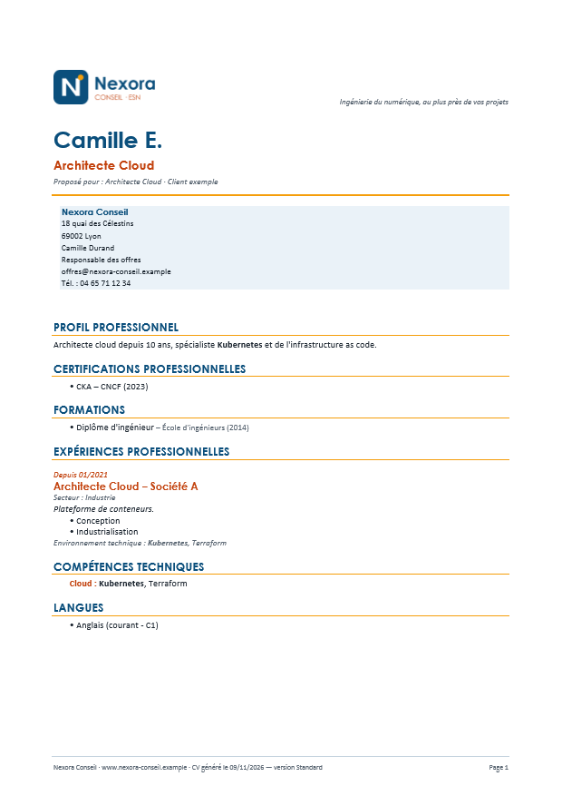
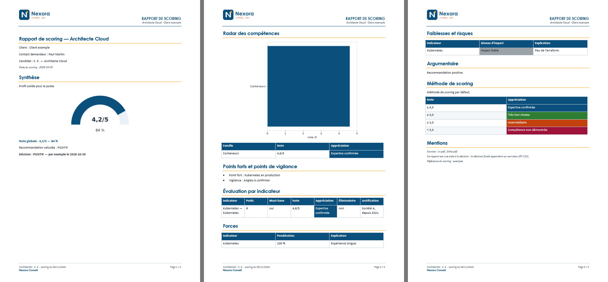
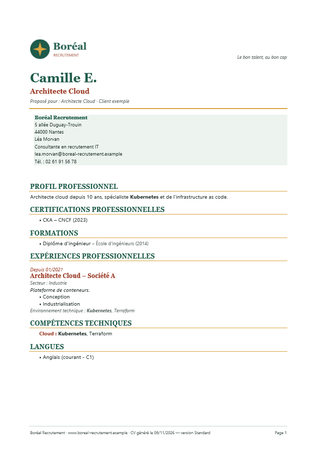
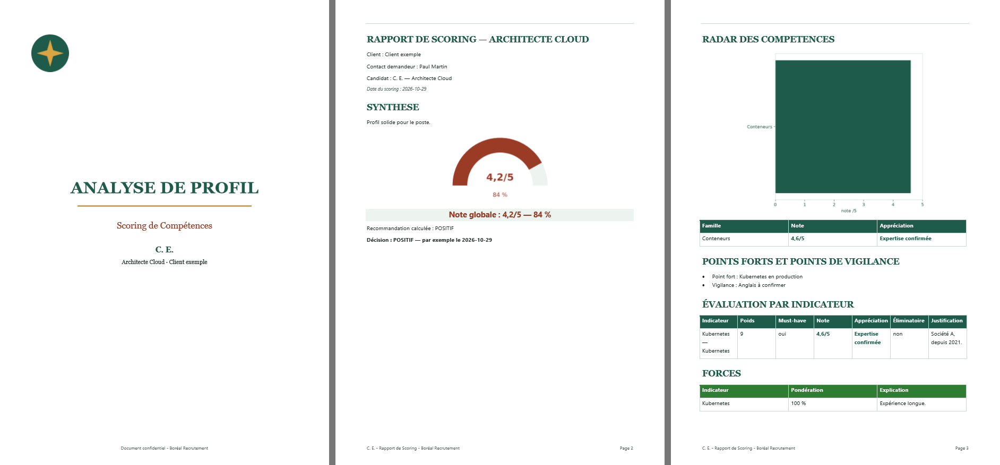

# Notice — Des CV et des rapports aux couleurs de votre entreprise

Cette notice explique comment obtenir, à partir du site web de votre entreprise, des gabarits Word qui reprennent
son identité graphique : couleurs, polices et logo. CVMatcher utilise ensuite ces gabarits pour chaque CV et chaque
rapport de scoring qu'il génère.

Comptez 15 à 30 minutes. Aucune connaissance technique n'est nécessaire si vous utilisez un assistant IA capable
d'exécuter du code (Claude, par exemple, avec la création de fichiers activée).

---

## 1. Ce que vous obtenez

Trois fichiers Word, à déposer dans **Administration ▸ Modèles** :

| Fichier | Famille | Contenu |
|---|---|---|
| `cv.<votre-société>.docx` | `cv` | CV : logo, nom et titre du candidat, bloc contact de votre interlocuteur, puis le CV |
| `rapport-scoring.<votre-société>.docx` | `rapport` | Rapport de scoring : logo et titre en en-tête de chaque page |
| `rapport-scoring-analyse.<votre-société>.docx` | `rapport` | Rapport « Analyse de profil » : page de garde, titres en capitales, tableaux zébrés |

Exemples fournis pour deux sociétés **fictives** : [`nexora-conseil/`](nexora-conseil/) (ESN) et
[`boreal-recrutement/`](boreal-recrutement/) (cabinet de recrutement). Les aperçus ci-dessous montrent le rendu
obtenu par CVMatcher avec ces gabarits.

| CV — Nexora Conseil | Rapport — Nexora Conseil |
|---|---|
|  |  |

| CV — Boréal Recrutement | Rapport « analyse » — Boréal Recrutement |
|---|---|
|  |  |

Les couleurs de votre site sont injectées à deux endroits des fichiers Word :

- **les styles** (titres, corps de texte, intitulés de poste, tableaux…) : vous pouvez les retoucher ensuite dans Word ;
- **la palette** CVMatcher : des propriétés du document nommées `cvm.…`, qui fixent les couleurs que l'application
  dessine elle-même (en-têtes de tableaux, niveaux d'appréciation, note globale, radar, jauge).

---

## 2. Avant de commencer

Rassemblez :

1. **l'adresse du site** de votre entreprise ;
2. **l'interlocuteur** affiché en première page des CV : nom, fonction, e-mail et téléphone professionnels (facultatif) ;
3. **votre logo** en PNG haute définition, si vous l'avez (facultatif, mais meilleur que celui trouvé sur le site) ;
4. **votre modèle de CV Word actuel**, si vous voulez le conserver (facultatif : il sera habillé plutôt que remplacé).

Utilisez uniquement le site, le logo et la charte de **votre propre entreprise**, ou d'une entreprise qui vous a
autorisé à le faire.

---

## 3. Générer les gabarits avec un assistant IA

1. Ouvrez une nouvelle conversation avec votre assistant IA.
2. Joignez les fichiers :
   - [`generer_gabarits.py`](generer_gabarits.py) ;
   - [`nexora-conseil/charte.json`](nexora-conseil/charte.json), qui sert d'exemple de format ;
   - votre logo et votre modèle de CV, si vous les avez.
3. Ouvrez [`prompt-gabarits-site-web.md`](prompt-gabarits-site-web.md), copiez le bloc **Prompt**, remplacez les
   valeurs entre `<< >>` (société, type, site, interlocuteur), puis envoyez-le.
4. L'assistant lit le site, propose les couleurs et les polices, puis produit les fichiers. Téléchargez :
   `charte.json`, `logo.png` (et `logo-seul.png`), et les trois `.docx`.

> **Votre assistant ne peut pas exécuter de code ?** Il s'arrête après avoir écrit `charte.json`. Passez au § 6
> pour lancer le script vous-même.

---

## 4. Relire le résultat

### Dans la réponse de l'assistant

- **Tableau des couleurs** : chaque couleur doit venir de votre site (variable CSS, bouton, logo). Une couleur
  « dérivée » a été inventée faute de mieux : à valider.
- **Contrôle des contrastes** : toutes les lignes doivent être marquées `ok`. Une couleur de marque trop claire pour
  du texte (jaune, orange vif, turquoise) est normalement gardée pour les filets décoratifs et assombrie pour le texte.
- **Points à vérifier** : confiance faible, logo de petite taille ou converti depuis un SVG, police remplacée.

### Dans Word

Ouvrez chaque `.docx` :

| Contrôle | Où regarder |
|---|---|
| Logo net et bien proportionné | En-tête, première page |
| Couleurs des titres et des filets | Page 1, volet **Styles** (styles `CV …`, `Titre 1`) |
| Polices | Accueil ▸ Police, sur un titre puis sur le texte |
| Palette CVMatcher | **Fichier ▸ Informations ▸ Propriétés ▸ Propriétés avancées**, onglet **Personnalisation** : propriétés `cvm.…` |
| Balises | Textes entre accolades : `{prenom}`, `{titre}`, `{corps}`… Ne les supprimez pas |

Le gabarit est presque vide : c'est normal. CVMatcher écrit tout le contenu à l'emplacement de la balise `{corps}`.

---

## 5. Ajuster

Trois façons de faire, de la plus simple à la plus fine :

1. **Demander à l'assistant**, dans la même conversation : « Mets le bleu en couleur secondaire », « Utilise le vert
   de la marque pour Très bon niveau », « Pas de zébrure dans les tableaux ». Il corrige la charte et régénère.
   D'autres exemples figurent à la fin du [prompt](prompt-gabarits-site-web.md#itérer-avec-lassistant).
2. **Modifier `charte.json`** puis relancer le script (§ 6). C'est la méthode à privilégier : la charte reste la
   référence et vous pourrez régénérer à tout moment.
3. **Retoucher dans Word** : styles (volet Styles ▸ clic droit ▸ Modifier), en-tête, pied de page, marges ;
   couleurs de la palette dans Fichier ▸ Informations ▸ Propriétés ▸ Propriétés avancées ▸ Personnalisation
   (sélectionnez la propriété `cvm.…`, changez la valeur `#RRGGBB`, cliquez sur **Modifier**).
   Attention : une régénération par le script écrase ces retouches.

---

## 6. Lancer le script soi-même

Prérequis : Python 3.10 ou plus récent.

```bash
pip install python-docx
```

Placez `charte.json`, `logo.png` et `logo-seul.png` dans un même dossier, puis :

```bash
python generer_gabarits.py mon-dossier/charte.json
```

Pour habiller votre modèle de CV existant plutôt que d'en créer un :

```bash
python generer_gabarits.py mon-dossier/charte.json --cv-base mon-modele-cv.docx
```

Les trois `.docx` sont écrits à côté de la charte (option `--out <dossier>` pour un autre dossier). Le script affiche
ensuite le contrôle des contrastes.

Avec `--cv-base`, seuls les styles `CV …` et la palette sont ajoutés à votre modèle : en-tête, pied de page, page de
garde et balises restent tels quels. Vérifiez que votre modèle contient la balise `{corps}` seule dans son
paragraphe, à l'endroit où le CV doit commencer.

---

## 7. Mettre les gabarits en service

1. **Administration ▸ Modèles** : choisissez le fichier, la famille (`cv` ou `rapport`) et un nom, puis **Déposer**.
2. Sur la carte du modèle, vérifiez :
   - **Balises** : `{corps}` figure dans la liste ;
   - **Couleurs du modèle** : une pastille par couleur de la palette ;
   - **Avertissements** : aucun.
3. Ouvrez l'**Exemple généré** et contrôlez le rendu.
4. Cliquez sur **Définir par défaut** pour l'utiliser dans les prochaines générations.

Un nouveau dépôt **sous le même nom** crée une nouvelle version, qui remplace la précédente.

**Interface aux mêmes couleurs.** Le dossier [`samples-theme/`](../samples-theme/README.md) fournit un prompt
équivalent pour le thème de l'interface web (Administration ▸ Thème). Donnez-lui les couleurs de `charte.json` pour
que l'application et les documents restent cohérents.

---

## 8. Référence

### Format de `charte.json`

| Section | Clé | Obligatoire | Usage |
|---|---|---|---|
| — | `slug` | non | Suffixe des fichiers produits (par défaut : nom de la société en minuscules) |
| `societe` | `nom` | oui | Pied de page, page de garde, nom affiché à défaut de logo |
| | `type`, `slogan`, `site` | non | Slogan en haut du CV, site en pied de page |
| | `adresse` | non | Lignes de l'adresse, dans le bloc contact du CV |
| | `contact` : `nom`, `fonction`, `email`, `telephone` | non | Interlocuteur du bloc contact du CV |
| `logo` | `fichier` | non | Logo complet (PNG ou JPEG), chemin relatif à la charte |
| | `marque` | non | Symbole seul, page de garde du rapport « analyse » (sinon : `fichier`) |
| `polices` | `titres`, `texte` | non | Polices Word (par défaut : Arial et Calibri) |
| `couleurs` | `primaire`, `secondaire` | oui | Titres, en-têtes de tableaux ; postes, sous-titres, dates |
| | `tertiaire` | non | Filets décoratifs, 3e série des graphiques |
| | `texte`, `texteSecondaire` | non | Texte courant ; dates, secteurs, pieds de page |
| | `fondClair`, `bordure`, `zebrure` | non | Bloc contact et bandeau de note ; bordures ; une ligne sur deux |
| | `succes`, `alerte`, `danger`, `neutre` | non | Tableau des forces ; impact moyen ; risques et impact fort ; impact faible |
| `niveaux` | `EXPERTISE_CONFIRMEE`, `TRES_BON_NIVEAU`, `INTERMEDIAIRE`, `COMPETENCE_NON_DEMONTREE`, `FORT`, `MOYEN`, `FAIBLE` | non | Couleur de chaque niveau d'appréciation et d'impact |
| `palette` | toute clé `cvm.*` sans le préfixe | non | Réglage fin, prioritaire sur tout le reste |
| `source` | libre | non | Traçabilité : méthode, URL lue, notes. Ignorée par le script |

Couleurs au format `#RRGGBB`. Le texte posé sur un fond coloré (en-têtes de tableaux, niveaux) est choisi
automatiquement, blanc ou sombre, selon le meilleur contraste.

### Clés de la palette (`palette` de la charte, ou propriétés `cvm.…` dans Word)

| Clé | Effet |
|---|---|
| `colors.text`, `colors.textMuted` | Texte des graphiques ; texte secondaire |
| `documents.headingColor`, `documents.accentColor` | Titres et postes des styles de repli |
| `documents.keywordColor` | Mots-clés mis en gras dans le CV |
| `documents.roles.<rôle>.color` | Couleur imposée à un rôle du CV : `section`, `period`, `exp_title`, `details`, `synthesis`, `environment`, `subheading`, `body`, `bullet`, `skills_heading`, `skills`, `formation`, `langues` |
| `documents.scoreText`, `documents.scoreBackground` | Ligne « Note globale » ; son fond (bandeau) |
| `documents.tableHeaderBackground`, `documents.tableHeaderText` | En-tête de tous les tableaux |
| `documents.tableBorder`, `documents.tableStripe` | Bordures ; zébrure (`aucune` pour la retirer) |
| `documents.tables.<tableau>.headerBackground` / `.headerText` / `.stripe` | Un seul tableau : `indicateurs`, `radar`, `forces`, `faiblesses`, `methode`, `comparatif` |
| `appreciation.<NIVEAU>.background` / `.text` | Niveaux `EXPERTISE_CONFIRMEE`, `TRES_BON_NIVEAU`, `INTERMEDIAIRE`, `COMPETENCE_NON_DEMONTREE` |
| `impact.<NIVEAU>.background` / `.text` | Niveaux `FORT`, `MOYEN`, `FAIBLE` |
| `documents.appreciationStyle`, `documents.impactStyle` | `FOND` (cellule colorée) ou `TEXTE` (libellé coloré en gras) |
| `charts.series` | Couleurs des graphiques, séparées par des virgules ; la 1re trace le radar |
| `charts.radarFill`, `charts.radarFillOpacity` | Remplissage du radar ; opacité entre 0 et 1 |
| `charts.labels`, `charts.grid` | Libellés et grille du radar |
| `charts.gaugeFill`, `charts.gaugeTrack`, `charts.gaugeText` | Arc de la jauge, fond de l'arc, note |

### Balises reconnues

| Gabarit | Balises |
|---|---|
| CV | `{prenom}`, `{nom}`, `{nom[0]}` (initiale), `{titre}`, `{client}`, `{poste}`, `{date}`, `{version}`, `{corps}` |
| Rapport | `{client}`, `{poste}`, `{candidat}`, `{date}`, `{corps}` |

---

## 9. Questions fréquentes

**Les polices de mon site ne sont pas reprises.** Word n'affiche que les polices installées sur le poste. La
génération choisit la police Microsoft Office la plus proche. Pour garder la police exacte, installez-la sur les
postes et indiquez son nom dans `polices`, ou incorporez-la au document (Fichier ▸ Options ▸ Enregistrement ▸
Incorporer les polices).

**Le logo est flou.** Fournissez un PNG d'au moins 600 px de large et indiquez-le dans `logo.fichier`.

**Une couleur de ma charte a été modifiée.** Elle n'était pas assez contrastée pour du texte (seuil 4,5:1). Elle
reste utilisée pour les filets et les graphiques ; seule sa version texte a été assombrie. Pour l'imposer malgré
tout, fixez-la dans la section `palette`, en connaissance de cause.

**Le dépôt signale « pas de balise {corps} ».** Le contenu sera ajouté à la fin du document. Ajoutez `{corps}`, seule
dans son paragraphe, à l'endroit voulu.

**Le dépôt est refusé.** Formats acceptés : `.docx` ou `.dotx`, 5 Mo au plus. Les fichiers à macros (`.docm`) sont
refusés. Réduisez la taille du logo si besoin.

**L'interlocuteur change.** Modifiez `societe.contact` dans la charte et relancez le script, ou corrigez directement
la première page du CV dans Word, puis redéposez le gabarit sous le même nom.
